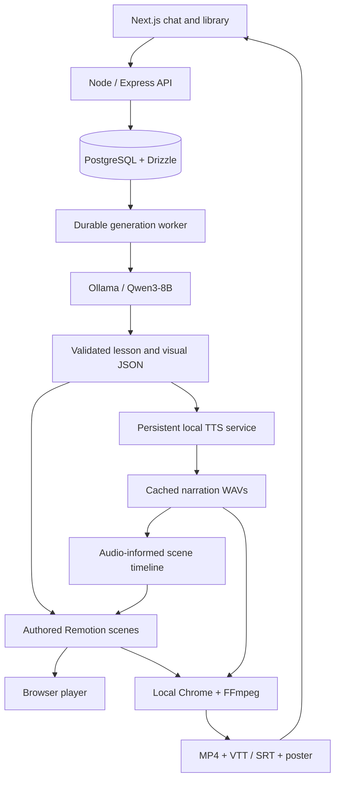

# Drishya

**Turn a concept or document into a narrated, animated explanation—using local models on your laptop.**

Built for the **Blu Visual Teacher Hackathon**, Drishya combines a chat workspace, a local lesson planner, authored animation components and multilingual speech. The result plays in the browser and exports as an MP4 with captions.

The generation pipeline uses **Qwen3-8B through Ollama** and **AI4Bharat Indic Parler TTS**. It does not call hosted AI, translation or speech APIs. A dedicated offline profile replaces Neon with local PostgreSQL so authentication, chats, uploads and generation can run without internet access after preparation.

## What you can do

- Describe a topic, paste a process or upload a document to explain.
- Confirm an editable preference card for language, audience, duration, visual style and output resolution. Preferences already present in the prompt are prefilled where recognized.
- Generate the script, narration, visuals and export through one background job.
- Watch the narrated Remotion preview while the downloadable MP4 renders.
- Keep conversations, preference selections, revisions and completed videos in a persistent library.
- Request follow-up changes, with reuse of unchanged narration and rendered segments where applicable.
- Generate Q&A and multiple-choice quizzes from a completed video's narration.
- Share a video with independently enabled Q&A and quiz sections. Quiz participants enter a name; the owner can view stored results.
- Create a language copy of an existing video and save star/message feedback.

Public sharing requires the recipient to reach the running application. A `localhost` link works only on the host computer; offline mode does not publish videos to the internet.

## Hackathon requirements and implementation

The brief asks for a **30–90-second lesson**, English plus at least two Indian languages, local JSON planning, reusable animated scenes, browser playback and a **1280×720 H.264/AAC MP4**.

| Stage | Drishya implementation |
| --- | --- |
| Concept input | Chat prompt or supported document, with level, language and target duration |
| Local lesson planning | Ollama structured output, Zod validation, bounded repair attempts and source-passage grounding for uploads |
| Visual engine | Authored React/Remotion scenes: headings, labelled diagrams, code walkthroughs, arrays, comparisons, charts and spatial/orbit views |
| Local narration | Persistent Indic Parler service; measured WAV duration feeds scene timing; bundled Indic fonts and captions |
| MP4 export | Local Chrome/Remotion frame rendering and FFmpeg audio/video assembly; media profile and audio validation before completion |

**Data, not executable model code:** generated plans are JSON. Diagram geometry, animation and execution demonstrations are implemented by the application. Python snippets are displayed as text; supported loop demonstrations use authored deterministic traces, not execution of generated Python or JavaScript.

For the hackathon demo, choose a duration within **30–90 seconds**. The application also supports longer requests: chapter proposals appear only when their combined estimated duration exceeds **120 seconds**, and require approval. This product extension is separate from the brief's short-lesson requirement.

### Current readiness

Video generation is available in **English, Hindi, Kannada and Telugu**. After the regional-language pipeline fixes, Kannada and Telugu generation was confirmed working by the user through the app. The revised path saves an English visual plan, translates and caches individual text fields, and fits regional narration one section at a time. This confirmation covers the tested app flow, not every possible topic or duration.

A built-in example exists at `/workspace/example`, but the current chat pipeline **does not automatically substitute a complete narrated fallback lesson when generation fails**. It shows the failure and retry controls. The brief's automatic fallback requirement remains an implementation gap.

## Architecture



The API saves work to PostgreSQL instead of running long inference inside an HTTP request. An independent worker claims jobs, records progress, maintains leases and performs bounded retries. Saved plans, speech cache entries and completed segments can be reused after interruption or edits. Recovery does not resume an unfinished model token stream or partially encoded frame.

Speech runs behind a private localhost HTTP boundary. Its Python process retains one model instance, serializes synthesis and writes PCM16 mono WAV files. The rest of Drishya talks to the service through a Node adapter.

Scene timing uses measured audio duration and playback rate, plus pauses. Fixed-length requests additionally use bounded script fitting, playback-rate adjustments and holds to meet the selected frame count. Captions are generally estimated from narration chunks; they are **not guaranteed word-level speech alignment**.

## Technology

| Area | Stack |
| --- | --- |
| Frontend | Next.js App Router, React, TypeScript |
| UI and state | Shared shadcn/Radix components, Zustand, Axios, TanStack Query |
| Backend | Node.js, Express, Better Auth credentials authentication |
| Persistence | PostgreSQL, Drizzle ORM and SQL migrations; Neon in the standard profile |
| Planning and translation | Local Ollama with `qwen3:8b` |
| Speech | AI4Bharat Indic Parler TTS, PyTorch, Python 3.11 |
| Animation | Remotion, React, SVG and Three.js-based components |
| Export | Installed Chrome, FFmpeg and FFprobe |
| Monorepo | pnpm workspaces and Turborepo |

## Prerequisites

Prepare these **before turning Wi-Fi off**:

- Node.js **24+** and pnpm **11.1.3**.
- Installed workspace dependencies.
- Ollama with the configured model downloaded: `qwen3:8b`.
- Python **3.11** with a working Indic Parler environment and cached model/tokenizers.
- PostgreSQL command-line tools: `initdb`, `pg_ctl`, `createdb`, `psql`.
- `ffmpeg`, `ffprobe` and installed Google Chrome.

Model weights, browser binaries and Python environments are not bundled in this repository. The offline preparation command checks prerequisites; it does not install them.

### 1. Install the workspace

From the repository root:

```sh
pnpm install --frozen-lockfile
cp apps/api/.env.example apps/api/.env
cp apps/web/.env.example apps/web/.env.local
cp services/inference/.env.example services/inference/.env
```

Do not overwrite existing configured environment files. All live credentials and generated media are gitignored.

### 2. Prepare local models

For a new machine, install Ollama and download the model while online:

```sh
ollama pull qwen3:8b
ollama list
```

Keep Ollama running. The API defaults to `http://127.0.0.1:11434`.

The current speech integration reuses this existing environment:

```text
~/AI/indic-tts/.venv/bin/python
```

It needs `torch`, `transformers`, `parler_tts`, `soundfile` and the locally cached `ai4bharat/indic-parler-tts` model, narration tokenizer and description tokenizer. Accept the model repository's access conditions and cache all required files while online. For a fresh environment, follow the [model's installation guide](https://huggingface.co/ai4bharat/indic-parler-tts) and the [speech-service documentation](services/inference/README.md).

**If that environment already works, reuse it.** The launcher never reinstalls packages, recreates the virtual environment or downloads model weights. The legacy `services/inference/requirements*.txt` files describe the earlier speech implementation and must not be used to recreate the current Indic Parler setup.

Recorded working Python package versions on the demo machine:

```text
Python           3.11
PyTorch          2.14.1
Transformers     4.46.1
Parler TTS       0.2.2
SoundFile        0.14.0
Hugging Face Hub 0.36.2
NumPy            2.4.6
SentencePiece    0.2.2
```

The installed Parler implementation comes from Hugging Face's `parler-tts` repository at commit `d108732cd57788ec86bc857d99a6cabd66663d68`. This is an environment inventory, not a claim that the repository's legacy requirements lock reproduces it.

### 3. Configure the services

Set the following in `apps/api/.env`:

| Variable | Purpose |
| --- | --- |
| `DATABASE_URL` | Standard-profile PostgreSQL/Neon connection; offline setup creates a separate local connection |
| `BETTER_AUTH_SECRET` | Random secret of at least 32 characters |
| `BETTER_AUTH_URL` | `http://localhost:3000` for local use |
| `OLLAMA_BASE_URL` | `http://127.0.0.1:11434` |
| `OLLAMA_MODEL` | Exact installed tag, normally `qwen3:8b` |
| `INFERENCE_URL` | `http://127.0.0.1:8001` |
| `INFERENCE_SECRET` | Random secret of at least 32 characters, matching the speech service |
| `MEDIA_ROOT` | `../../data` for the standard profile |

In `services/inference/.env`, match `INFERENCE_SECRET`, set `TTS_PYTHON` to the existing interpreter and use `DRISHYA_DATA_DIR=../../data`. In `apps/web/.env.local`, use `API_URL=http://127.0.0.1:4000`. The frontend proxies API requests through the same origin; no backend secret belongs in a `NEXT_PUBLIC_*` variable.

Chrome and FFmpeg paths can be overridden with `CHROME_PATH`, `FFMPEG_PATH` and `FFPROBE_PATH`.

## Run completely locally

```sh
# Check prerequisites, cached speech configuration and the installed Ollama model.
pnpm offline:check

# Create/reuse the dedicated local PostgreSQL cluster and apply migrations.
pnpm offline:prepare

# Stop any standard-profile Drishya processes, then start all four services.
pnpm dev:offline
```

Open **http://localhost:3000** and register a **local Drishya account**. The offline profile uses its own database, auth secret and cookie prefix. Online accounts, chats and videos are not automatically copied; the existing Neon data stays intact.

| Service | Address |
| --- | --- |
| Web app | `http://localhost:3000` |
| API health | `http://127.0.0.1:4000/api/health` |
| Private TTS | `http://127.0.0.1:8001` |
| Ollama | `http://127.0.0.1:11434` |
| Offline PostgreSQL | `127.0.0.1:55432` |

The local cluster lives in `data/postgres`; generated connection settings are in `.env.offline` with mode `0600`. Offline media lives in `data/offline`. Every offline startup applies pending migrations. Local endpoint checks prevent accidentally using a hosted database or model endpoint in this profile.

After preparation and startup, disconnect Wi-Fi and use the app through `localhost`. Hugging Face inference is forced offline and model loads use `local_files_only=True`. Fonts, scene components and procedural background audio are local assets. Missing dependencies or model files must be prepared while online; they are not downloaded during generation.

Stop the development command with **Ctrl+C**, then stop the local database when finished:

```sh
pnpm offline:stop
```

To use the standard profile instead, stop the offline services, configure `DATABASE_URL`, then run:

```sh
pnpm db:migrate
pnpm dev
```

The standard profile requires internet when its database is Neon, even though its AI models still run locally. Do not run both profiles on the same ports.

## Languages and voices

| Language | Code | Active speaker | Status |
| --- | --- | --- | --- |
| English | `en` | Thoma | Local speech and completed videos |
| Hindi | `hi` | Rohit | Local speech and completed videos |
| Kannada | `kn` | Suresh | Speech and video generation confirmed in user app testing |
| Telugu | `te` | Prakash | Speech and video generation confirmed in user app testing |

These are speaker names from the Indic Parler model, not custom cloned voices. Only the original male profiles are active. Female selection and experimental Whisper-based speech verification are disabled. Pronunciation and translation require human review; the application does not guarantee error-free narration.

## Documents, learning and revisions

Uploads support text-based **PDF, DOCX, TXT, Markdown and CSV**, up to three files of 10 MB each. Extracted source text is limited to 12,000 characters per conversation. Scanned PDFs require OCR outside the application. Original document binaries are not retained.

Uploaded text is passed separately from the user's request. Source passages receive application-authored IDs; the planner selects passages and the application attaches the original quoted text for provenance checks. Document contents are treated as reference data, not instructions to execute. These checks reduce unrelated explanations but are not a general fact-checking system.

Quizzes and Q&A are generated independently from saved video narration. Share tokens are stored as hashes, visibility is configurable and links can be revoked. Quiz answers are graded on the server, attempts persist, and participant names are self-reported. Feedback is saved for future reporting; there is no admin dashboard yet.

See [video features](docs/VIDEO-FEATURES.md), [architecture](docs/V2-ARCHITECTURE.md) and [Python-loop demonstrations](docs/PYTHON-LOOP-VISUALS.md) for implementation details. Some historical documents describe earlier experiments; the active voice configuration above takes precedence.

## Demo and submission

Suggested live demonstration:

1. Prepare the local profile and cached models, then disable Wi-Fi.
2. Open `localhost:3000`, sign into the local account and start a chat.
3. Enter: **“Explain how a Python for loop works for a beginner in English in 30 seconds.”**
4. Confirm preferences and show the persisted job progress.
5. Play the result, including code highlights, changing state and output; download the MP4.
6. Generate an Indian-language lesson, then show its narration, native-script captions and saved library entry. Review the selected demo topic and duration beforehand.

The brief asks for two topics—one judge-provided and one chosen by the team—with **each topic in English and one Indian language**. Prepare and review all four exports. Generated files are gitignored; they must be attached to the submission separately or deliberately packaged.

A repaired 60-second English Python-loops export is available on the demo machine at:

```text
data/offline/Drishya-Python-Loops-Repaired.mp4
```

That local file is not automatically included in a fresh clone. No claim is made here that the required judge-topic exports or all four submission files have been assembled.

## Tested hardware and performance

| Item | Demo machine |
| --- | --- |
| Laptop | MacBook Pro, Apple M5 (`Mac17,2`) |
| Memory | 16 GB unified memory |
| OS | macOS 26.5.2 |
| Node / pnpm | 24.15.0 / 11.1.3 |
| Speech interpreter | Existing Python 3.11 virtual environment |
| Acceleration | PyTorch MPS on Apple Silicon |

The speech provider has a CPU fallback, but **a complete CPU-only run on an 8–16 GB laptop has not been benchmarked**. The hackathon's CPU-only requirement must not be inferred from the MPS demo.

Historical fresh 30-second worker runs completed in approximately **238–304 seconds**, with narrated previews at **158–232 seconds**. These used different prompts and intermediate code revisions, so they are not a controlled benchmark of the final checkout. Earlier regional-language failures prompted the canonical-plan and cached-translation fixes; those historical runs do not measure the corrected path. The target of a roughly two-minute 720p export is **not a measured guarantee**.

See [the performance report](docs/PERFORMANCE-REPORT.md) for per-stage measurements and methodology. Job telemetry is stored under the active media root's `v2/metrics/` directory and distinguishes queue waits, worker attempts, Qwen calls, speech, fitting and render stages.

## Models, voices and asset licences

| Component | Use | Licence / source |
| --- | --- | --- |
| Qwen3-8B | Local planning, text generation and translation | Apache-2.0 — [model card](https://huggingface.co/Qwen/Qwen3-8B) |
| Ollama | Local model runtime | MIT — [licence](https://github.com/ollama/ollama/blob/main/LICENSE) |
| AI4Bharat Indic Parler TTS | Speech weights and built-in Thoma/Rohit/Suresh/Prakash profiles | Apache-2.0 listed by the [model card](https://huggingface.co/ai4bharat/indic-parler-tts); observe its download/access conditions |
| Parler TTS implementation | Speech inference code | Apache-2.0 — [licence](https://github.com/huggingface/parler-tts/blob/main/LICENSE) |
| Remotion 4.0.539 | Preview and video rendering | Remotion's own Free/Company licence, **not MIT**; eligibility and restrictions apply — [terms](https://www.remotion.dev/docs/license) and installed package licence |
| Inter, Manrope, Instrument Serif, IBM Plex Mono and Noto Sans Indic fonts | Bundled UI/video typography | SIL Open Font License 1.1, as recorded by the installed Fontsource packages |
| Lucide icons | Interface icons | ISC — [licence](https://github.com/lucide-icons/lucide/blob/main/LICENSE) |
| FFmpeg / FFprobe | Media encoding, probing and assembly | LGPL-2.1-or-later or GPL depending on build options — [licensing](https://ffmpeg.org/legal.html); inspect the installed binary before redistributing |
| Drishya scenes and procedural soundtrack | Application-authored visuals and generated score/effects | Source in this repository; no downloaded stock music or third-party model assets are required |

Built-in voices are used through the published model; no separately acquired voice pack or custom voice recordings are shipped. Model, dataset and runtime terms are distinct: linked model metadata is not a blanket licence for unrelated training datasets or assets. Preserve applicable upstream notices when redistributing packages or weights.

This repository currently has **no project-level LICENSE file**. Third-party licences do not assign a licence to Drishya's own source code.

## Repository layout

```text
apps/
  web/                 Next.js chat, library, player and shared quizzes
  api/                 Express, auth, uploads, jobs and media endpoints
  worker/              Independent generation-worker launcher
services/
  inference/           Persistent local Python speech service
packages/
  ai/                  Ollama planner/director, localization and scene preparation
  contracts/           Shared Zod schemas and timeline contracts
  db/                  Drizzle schema and SQL migrations
  motion/              Remotion animation components and execution traces
  renderer/            Legacy authored scene renderer
  ui/                  Shared UI components and theme
scripts/
  offline.mjs          Local PostgreSQL preparation and offline startup
docs/                  Architecture, feature notes and performance evidence
```

## Useful commands

```sh
pnpm dev                 # Standard-profile web, API, worker and TTS
pnpm dev:offline         # Local-profile services and migration check
pnpm offline:check       # Readiness checks without installing models
pnpm offline:prepare     # Create/reuse local database and migrate
pnpm offline:stop        # Stop the local PostgreSQL cluster
pnpm typecheck           # Workspace TypeScript checks
pnpm check               # Biome lint/format checks
pnpm build               # Build workspace applications
pnpm db:migrate          # Apply migrations to the configured standard database
pnpm db:generate         # Generate migrations after schema changes
pnpm db:check            # Read-only connection check
```

`pnpm --filter @drishya/worker dev` starts only the **standard-profile** worker. For offline use, start the complete stack with `pnpm dev:offline` so every process receives the same local database and media settings.
